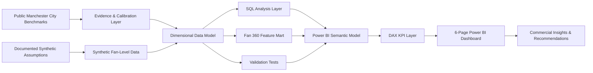
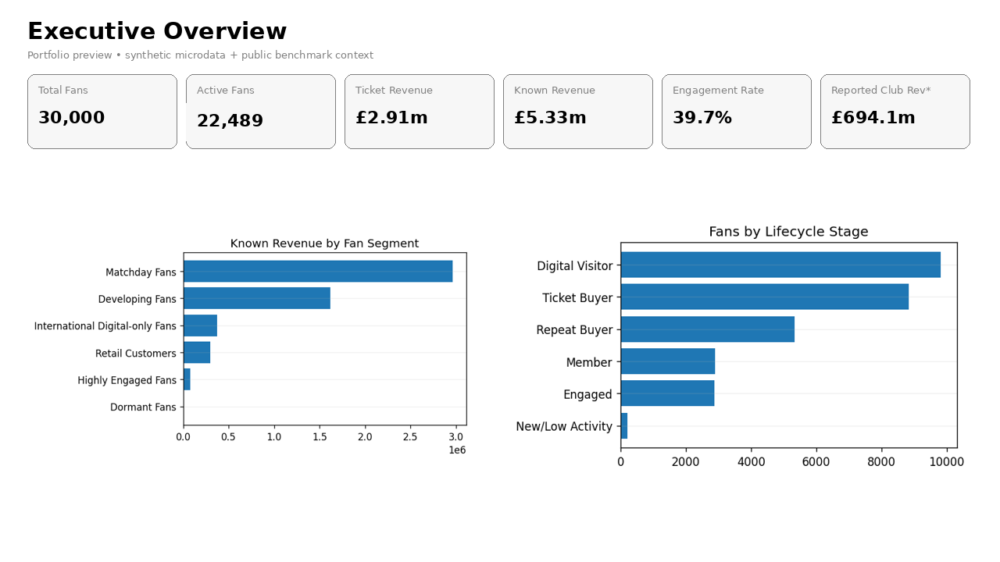
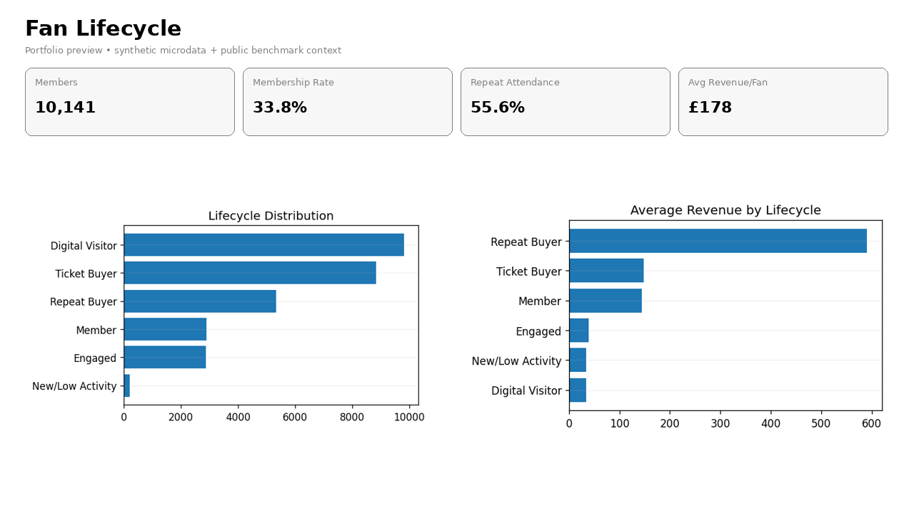
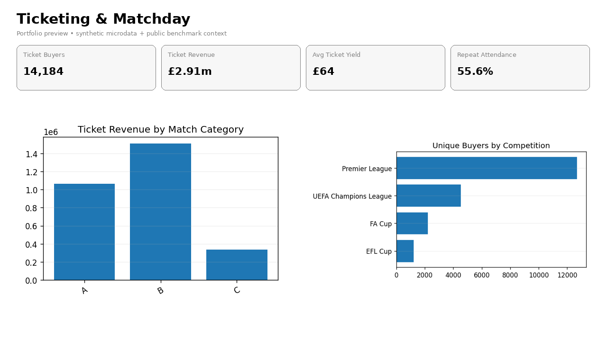
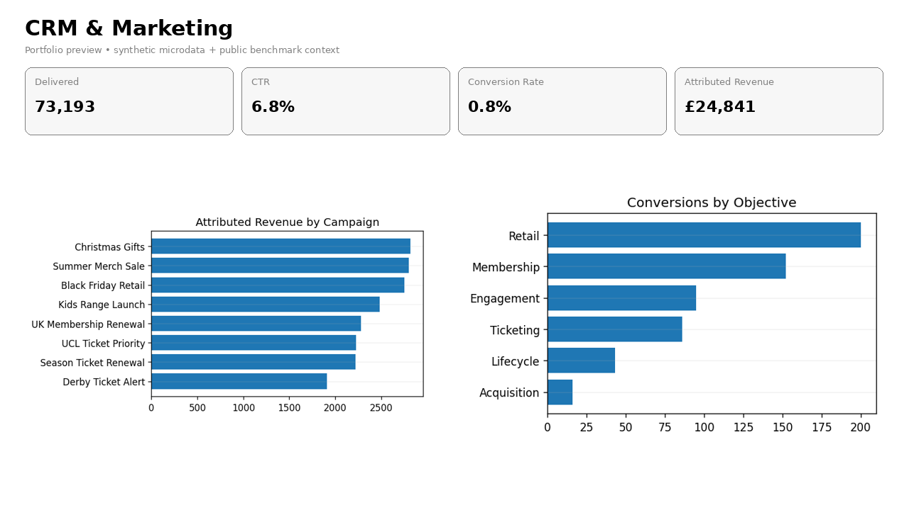
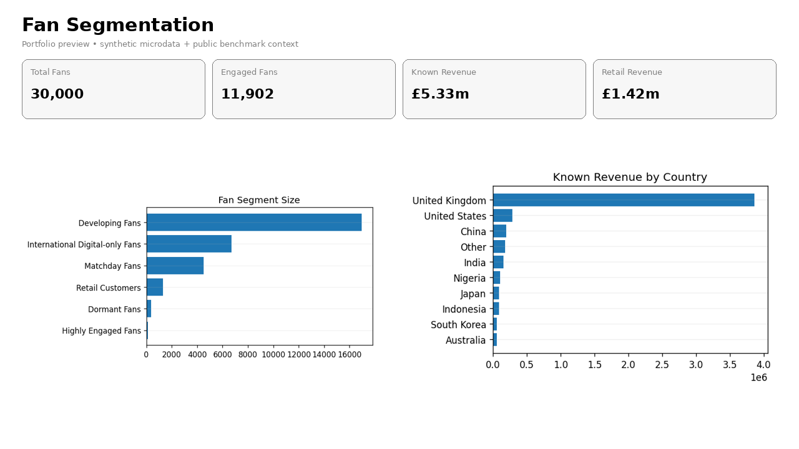
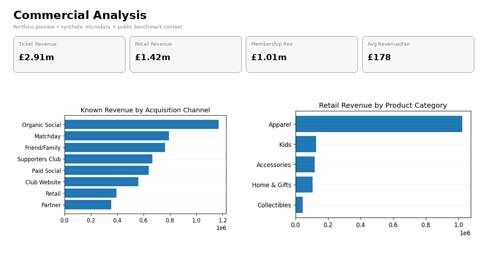

# Football Fan Intelligence & Commercial Analytics

**Manchester City–inspired portfolio case study | SQL • Power BI • DAX • Dimensional Modeling • CRM Analytics • Customer Lifecycle • Commercial Analytics**

This project models the type of **fan intelligence, lifecycle marketing, CRM, ticketing, retail, and commercial analytics** problem faced by a global football club.

The objective is not to reproduce Manchester City's private internal data. Instead, the project combines:

- **publicly reported Manchester City benchmarks** where reliable information is available;
- **public fixture/result context** for the 2024/25 season; and
- **explicitly synthetic fan-level analytical data** for CRM, ticket purchases, memberships, retail transactions, digital engagement, and campaign interactions, because those records are not publicly available.

The result is an end-to-end analytics project designed to answer three management questions:

> **What is happening?**  
> **Why does it matter?**  
> **Where are the commercial opportunities?**

> **Important:** This is an independent portfolio project and is **not affiliated with, endorsed by, or based on confidential data from Manchester City Football Club**. All fan-level records are synthetic and are labelled accordingly throughout the project.

---

## 1. Project Background

Modern football clubs operate as both sporting organisations and global consumer businesses. A fan may first interact with a club through social media, visit the website, join a membership programme, buy merchandise, attend a match, respond to a CRM campaign, and eventually become a high-value repeat customer.

The analytical challenge is that these interactions sit across different systems and have different levels of commercial intent. Looking at ticket sales, social engagement, or campaign clicks separately gives only a partial view of the fan relationship.

This project therefore builds a **Fan 360 analytical model** that connects the main stages of the customer lifecycle:

```text
Awareness / Acquisition
        ↓
Digital Visitor
        ↓
Engaged Fan
        ↓
Member
        ↓
Ticket Buyer / Retail Customer
        ↓
Repeat Buyer
        ↓
High-Value / Highly Engaged Fan
```

The project was designed around the type of work expected from a **Fan Intelligence / Commercial Analytics / CRM Analytics** team rather than a football-performance analytics team. The focus is therefore on customer behaviour, conversion, revenue, engagement, segmentation, and decision support—not player xG, passing networks, or tactical performance.

---

## 2. Business Objective

The main objective is to create a decision-support environment that gives commercial and marketing stakeholders one consistent view of the fan base.

The analysis is designed to support questions such as:

- How large is the modeled fan base and how many fans are active or commercially engaged?
- How many fans progress from digital engagement to membership, ticket purchase, and repeat attendance?
- Where are the largest lifecycle drop-offs?
- Which fan segments generate the most known commercial revenue?
- Which highly engaged fans have not yet converted commercially?
- How does geography affect ticketing, retail, and membership behaviour?
- Which acquisition channels bring commercially valuable fans?
- Which match categories and competitions generate the strongest ticket demand and yield?
- Which CRM campaigns generate clicks, conversions, and attributed revenue rather than only reach?
- Which product categories contribute most to modeled retail revenue?
- Which customer groups should receive conversion, retention, cross-sell, or win-back activity?

---

## 3. Project Scope

The project covers the 2024/25 analytical season and contains two deliberately separated evidence layers.

### 3.1 Public benchmark layer

This layer contains club-level figures that are publicly reported and are used as context or calibration constraints.

Examples include:

| Public benchmark | 2024/25 value | Use in this project |
|---|---:|---|
| Total club revenue | £694.1m | Executive context only |
| Matchday revenue | £75.1m | Club-level benchmark only |
| Broadcast revenue | £278.6m | Club-level benchmark only |
| Commercial revenue | £340.4m | Club-level benchmark only |
| Total social followers | 194m | Digital scale context |
| Avg. monthly active users | 52m | Digital scale context |
| Video views | 13.9bn | Digital scale context |
| Social engagements | 1.4bn | Digital scale context |
| Avg. Premier League home attendance | 52,517 | Attendance calibration |
| Premier League occupancy | 99.7% | Matchday context |
| Tickets sold across competitions | 1.4m | Match allocation calibration |
| Official Supporters Clubs | 405 | International fan context |
| Countries with Supporters Clubs | 74 | International fan context |

These values are stored separately from the synthetic customer-level model so that a modeled transaction total is never presented as an audited Manchester City result.

### 3.2 Synthetic fan-level analytical layer

Actual fan CRM records, individual ticket purchases, membership transactions, merchandise transactions, and campaign-response records are not public. For that reason, the project generates a controlled synthetic dataset that follows realistic behavioural patterns and documented assumptions.

The synthetic layer contains:

- **30,000** modeled fans;
- **45,505** ticket transaction lines from **14,184** ticket buyers;
- **28,789** retail transaction lines from **10,278** retail buyers;
- **10,141** membership transactions;
- **145,000** digital engagement rows; and
- **74,640** CRM campaign interactions.

Synthetic data is used to demonstrate analytical technique—not to claim knowledge of the club's internal CRM performance.

---

## 4. Data Inputs

The project uses three input categories.

### A. Public reported benchmarks

Stored in:

```text
data/public_benchmarks/
```

Files:

| File | Description |
|---|---|
| `club_revenue_2020_25.csv` | Matchday, broadcast, commercial, and total revenue history |
| `social_media_benchmarks.csv` | Reported social follower, active user, video-view, and engagement figures |
| `matchday_benchmarks.csv` | Average Premier League home attendance, occupancy, and total tickets sold |
| `supporters_clubs_benchmarks.csv` | Official Supporters Club footprint |
| `home_matches_2024_25_hybrid.csv` | Public fixture/result metadata plus clearly labelled synthetic attendance/ticket estimates |

Main public sources:

- Manchester City Annual Report 2024/25 — Business Performance:  
  https://www.mancity.com/annualreport2025/business-performance/
- Manchester City Annual Report 2024/25 — Media:  
  https://www.mancity.com/annualreport2025/media/
- Manchester City Annual Report 2024/25 — Matchday:  
  https://www.mancity.com/annualreport2025/matchday/
- Manchester City Annual Report 2024/25 — Membership & Supporters Clubs:  
  https://www.mancity.com/annualreport2025/membership-supporters-clubs/

A full source register is available in [`docs/SOURCE_REGISTER.md`](docs/SOURCE_REGISTER.md).

### B. Synthetic analytical microdata

Stored in:

```text
data/synthetic_microdata/
```

Core tables:

| Table | Grain | Purpose |
|---|---|---|
| `dim_fan.csv` | One row per modeled fan | Demographics, geography, acquisition, membership status |
| `dim_date.csv` | One row per date | Calendar dimension |
| `dim_match.csv` | One row per home fixture | Competition, opponent, match category, attendance context |
| `dim_product.csv` | One row per modeled SKU | Merchandise category and modeled price |
| `dim_campaign.csv` | One row per modeled CRM campaign | Campaign objective, channel, timing |
| `fact_ticket_sales.csv` | Fan × match × ticket line | Ticket transactions and modeled revenue |
| `fact_retail_transactions.csv` | Fan × product × transaction | Merchandise transactions |
| `fact_membership.csv` | Fan × membership transaction | Membership purchases |
| `fact_digital_engagement.csv` | Fan × platform engagement event | Sessions, content views, engagement actions |
| `fact_campaign_interactions.csv` | Fan × campaign interaction | Delivered, opened, clicked, converted, attributed revenue |
| `fan_360_features.csv` | One row per fan | Derived lifecycle, segmentation, activity and revenue features |

### C. Analytical rules and assumptions

The assumptions are not hidden in code. They are documented in:

- [`docs/ASSUMPTIONS.md`](docs/ASSUMPTIONS.md)
- [`docs/METHODOLOGY.md`](docs/METHODOLOGY.md)
- [`docs/DATA_DICTIONARY.md`](docs/DATA_DICTIONARY.md)

A fixed random seed of **42** is used to keep the synthetic analytical dataset reproducible.

---

## 5. End-to-End Analytical Workflow

The project follows the pipeline below.



In practical terms, the project moves through the following stages:

1. **Define the commercial problem and decision questions.**
2. **Collect public benchmark information** that can be defended from official sources.
3. **Define the boundary between real and synthetic data.**
4. **Create realistic fan-level synthetic records** for non-public CRM and transaction data.
5. **Calibrate selected synthetic outputs** against public matchday constraints.
6. **Build a dimensional/star-schema analytical model.**
7. **Create SQL queries** for data quality, lifecycle, segmentation, commercial KPIs, CRM, and matchday analysis.
8. **Build a Fan 360 feature mart** at one row per fan.
9. **Define DAX measures and KPI logic** in the Power BI semantic model.
10. **Create six decision-oriented dashboard pages.**
11. **Validate referential integrity and major calibration rules.**
12. **Translate the outputs into commercial interpretation and opportunity areas.**

---

## 6. Synthetic Data Methodology

The synthetic model is designed to preserve plausible relationships between fan characteristics and behaviour rather than generating unrelated random numbers.

### 6.1 Fan base

The model contains 30,000 fans across the UK and international markets.

Key design assumptions include:

- the **United Kingdom is the largest modeled market**;
- international cohorts include the United States, China, India, Nigeria, Indonesia, Japan, South Korea, Australia, Germany, Brazil, UAE, France, Spain, and other markets;
- fans can originate from acquisition channels such as Organic Social, Paid Social, Club Website, Matchday, Supporters Club, Retail, Partner, or Friend/Family;
- UK fans and fans acquired through matchday/supporters-club channels have higher modeled membership and attendance propensity.

### 6.2 Ticketing

Ticket behaviour is generated using different fan propensities rather than applying one uniform probability to all customers.

The model assumes:

- season-ticket members have the highest repeat-attendance frequency;
- ordinary members have higher ticket propensity than non-members;
- UK fans have higher matchday access than international fans;
- one-off attendance is more common among international/non-member fans;
- higher-profile match categories carry higher modeled ticket yield.

The resulting modeled **repeat-attendance rate is 55.6%**, avoiding an unrealistic dataset in which nearly every buyer repeatedly attends.

Matchday calibration rules include:

- modeled Premier League home attendance averages exactly **52,517**; and
- modeled ticket allocation across 27 home fixtures sums to **1.4 million**, matching the published season-level tickets-sold benchmark used for calibration.

The individual fan ticket transactions remain synthetic even when the aggregate calibration uses a public figure.

### 6.3 Retail

The model contains a small merchandise catalogue across categories such as:

- Apparel;
- Accessories;
- Collectibles;
- Home & Gifts; and
- Kids.

Retail purchase propensity varies by fan profile. Members and more engaged fans have moderately higher modeled purchase probability.

Prices are plausible portfolio values and are **not claimed to be historical Manchester City Shop prices**.

### 6.4 Membership

Membership status is incorporated into both lifecycle and propensity modelling.

The modeled membership types are:

- Non-member;
- Cityzens Membership;
- Matchday Membership; and
- Season Ticket.

The model contains **10,141 members**, representing a modeled membership rate of **33.8%** within the 30,000-fan analytical sample.

### 6.5 Digital engagement

Digital behaviour is represented through sessions, content views, engagement actions, and platform interaction.

Modeling assumptions include:

- younger fan cohorts have moderately higher digital activity;
- members are more likely to be highly engaged;
- platforms such as Instagram and TikTok have higher synthetic interaction propensity;
- public figures such as 194m followers and 13.9bn video views are used as context only and are **not scaled down mathematically into the 30,000-fan sample**.

### 6.6 CRM campaign funnel

CRM interactions enforce a valid funnel:

```text
Delivered → Opened → Clicked → Converted
```

A row cannot be converted without being clicked, clicked without being opened, or opened without being delivered.

Campaigns represent objectives including:

- Acquisition;
- Engagement;
- Lifecycle;
- Membership;
- Retail; and
- Ticketing.

Attributed campaign revenue is modeled for portfolio analysis and should not be interpreted as proven incremental or causal revenue.

---

## 7. Data Model

The analytical layer follows a dimensional/star-schema design.

### Dimensions

- `DimFan`
- `DimDate`
- `DimMatch`
- `DimProduct`
- `DimCampaign`

### Fact tables

- `FactTicketSales`
- `FactRetailTransactions`
- `FactMembership`
- `FactDigitalEngagement`
- `FactCampaignInteractions`

### Analytical mart

- `Fan360Features`

Conceptually:

```text
                         DimDate
                            │
                            │
DimFan ───────────── FactTicketSales ─────────── DimMatch
   │
   ├─────────────── FactRetailTransactions ───── DimProduct
   │
   ├─────────────── FactMembership
   │
   ├─────────────── FactDigitalEngagement
   │
   └─────────────── FactCampaignInteractions ─── DimCampaign
   │
   └─────────────── Fan360Features
```

This structure avoids a single denormalised table and allows each business process to retain its correct grain.

For example:

- ticket revenue is calculated from ticket-line facts;
- CRM conversion is calculated from campaign interactions;
- fan-level segmentation is calculated from the aggregated Fan 360 mart;
- match properties are stored once in the match dimension rather than repeated as descriptive attributes throughout every analytical table.

The SQL schema is defined in [`sql/00_create_schema.sql`](sql/00_create_schema.sql).

---

## 8. Fan 360 Feature Engineering

`fan_360_features.csv` is the main customer-level analytical mart.

It combines each fan's:

- membership status;
- acquisition channel;
- geography;
- ticket purchase count;
- distinct matches attended;
- ticket revenue;
- retail purchase count;
- retail revenue;
- membership revenue;
- digital sessions;
- content views;
- engagement actions;
- CRM campaigns received;
- campaign clicks;
- campaign conversions;
- campaign-attributed revenue;
- total known modeled commercial revenue;
- lifecycle stage; and
- fan segment.

The mart can be rebuilt with:

```bash
python scripts/rebuild_feature_mart.py
```

This creates one consistent fan-level table for lifecycle, segmentation, and commercial analysis while preserving the detailed fact tables for lower-grain investigation.

---

## 9. Lifecycle Method

A mutually exclusive lifecycle stage is assigned to each modeled fan using behavioural rules.

The hierarchy is:

```text
Repeat Buyer
    ↓
Ticket Buyer
    ↓
Member
    ↓
Engaged
    ↓
Digital Visitor
    ↓
New / Low Activity
```

The implemented logic is approximately:

- **Repeat Buyer** — member with at least two ticket purchase records;
- **Ticket Buyer** — at least one ticket purchase;
- **Member** — member with no qualifying ticket purchase;
- **Engaged** — at least eight engagement actions;
- **Digital Visitor** — at least one digital session;
- **New/Low Activity** — none of the above.

The modeled distribution is:

| Lifecycle stage | Fans | Known modeled revenue |
|---|---:|---:|
| Digital Visitor | 9,825 | £329,970 |
| Ticket Buyer | 8,842 | £1,308,565 |
| Repeat Buyer | 5,342 | £3,157,268 |
| Member | 2,902 | £420,134 |
| Engaged | 2,869 | £110,745 |
| New/Low Activity | 220 | £7,588 |

The purpose is not to claim this is Manchester City's internal lifecycle taxonomy. It demonstrates how raw customer interactions can be converted into an operational lifecycle view.

The SQL implementation is available in [`sql/03_customer_lifecycle.sql`](sql/03_customer_lifecycle.sql).

---

## 10. Fan Segmentation Method

The project also creates mutually exclusive behavioural segments designed for commercial activation.

### Highly Engaged Fans

High engagement and meaningful known commercial value.

### Matchday Fans

Fans attending at least three modeled home matches.

### International Digital-only Fans

International fans with meaningful digital activity but no ticket purchases.

### Retail Customers

Fans with material retail spending but no ticket purchases.

### Dormant Fans

Fans with very low digital activity and no known modeled revenue.

### Developing Fans

Fans who do not yet meet one of the more specific behavioural segment rules.

Modeled segment summary:

| Fan segment | Fans | Known revenue | Avg. revenue/fan | Avg. digital sessions |
|---|---:|---:|---:|---:|
| Developing Fans | 16,952 | £1,616,434 | £95.35 | 16.95 |
| International Digital-only Fans | 6,709 | £376,188 | £56.07 | 24.95 |
| Matchday Fans | 4,496 | £2,965,183 | £659.52 | 24.63 |
| Retail Customers | 1,322 | £299,751 | £226.74 | 13.91 |
| Dormant Fans | 386 | £0 | £0.00 | 0.91 |
| Highly Engaged Fans | 135 | £76,713 | £568.24 | 61.90 |

This segmentation is intended to support different interventions rather than rank fans as “good” or “bad.” For example, an international digital-only fan may be commercially valuable through membership, content, or retail even when match attendance is unrealistic.

The reference rules are implemented in `scripts/rebuild_feature_mart.py` and analysed through [`sql/04_fan_segmentation.sql`](sql/04_fan_segmentation.sql).

---

## 11. KPI Definitions

The project uses explicit business definitions rather than relying on ambiguous visual labels.

| KPI | Definition |
|---|---|
| **Total Fans** | Distinct modeled `FanID` |
| **Active Fan** | ≥30 digital sessions OR ≥1 ticket/retail purchase OR membership OR campaign click |
| **Member** | Fan with modeled membership status |
| **Membership Rate** | Members / Total Fans |
| **Ticket Buyers** | Distinct fans with ticket transactions |
| **Ticket Revenue** | Sum of modeled net ticket revenue |
| **Avg Ticket Yield** | Ticket revenue / modeled ticket quantity |
| **Repeat Attendance Rate** | Fans attending ≥2 distinct home matches / ticket buyers |
| **Retail Revenue** | Sum of modeled net retail revenue |
| **Membership Revenue** | Sum of modeled membership revenue |
| **Known Commercial Revenue** | Ticket + Retail + Membership modeled revenue |
| **Avg Revenue per Fan** | Known Commercial Revenue / Total Fans |
| **Engaged Fan** | Fan with ≥8 modeled engagement actions |
| **Fan Engagement Rate** | Engaged Fans / Total Fans |
| **CRM CTR** | Clicked / Delivered |
| **CRM Conversion Rate** | Converted / Delivered |
| **Campaign Attributed Revenue** | Sum of modeled revenue attributed to CRM interactions |

The same definitions are documented in [`docs/DATA_DICTIONARY.md`](docs/DATA_DICTIONARY.md) and implemented in the Power BI semantic model.

---

## 12. SQL Analysis Layer

The repository includes SQL Server / Azure SQL compatible analytical scripts.

```text
sql/
├── 00_create_schema.sql
├── 01_data_quality_checks.sql
├── 02_commercial_kpis.sql
├── 03_customer_lifecycle.sql
├── 04_fan_segmentation.sql
├── 05_campaign_performance.sql
└── 06_matchday_analysis.sql
```

### `00_create_schema.sql`

Defines the dimensional model and fact-table structure.

### `01_data_quality_checks.sql`

Used to test key integrity and analytical assumptions before reporting.

### `02_commercial_kpis.sql`

Aggregates ticket, retail, and membership revenue at fan level to produce major commercial KPIs.

### `03_customer_lifecycle.sql`

Creates the lifecycle classification based on membership, ticketing, and digital behaviour.

### `04_fan_segmentation.sql`

Summarises the Fan 360 behavioral segmentation.

### `05_campaign_performance.sql`

Calculates delivered, opened, clicked, converted, attributed revenue, open rate, CTR, and click-to-conversion performance by campaign.

### `06_matchday_analysis.sql`

Analyses home matches by competition and match category, including attendance, modeled ticket revenue, and unique buyers.

The SQL layer is included so the project demonstrates analytical reasoning before visualization rather than treating Power BI as the only analysis environment.

---

## 13. Power BI Semantic Model and DAX

The Power BI deliverable is stored as a **Power BI Project (`.pbip`)** with text-based report and semantic-model definitions.

```text
powerbi/
├── Manchester_City_Fan_Intelligence.pbip
├── Manchester_City_Fan_Intelligence.Report/
├── Manchester_City_Fan_Intelligence.SemanticModel/
├── dax_measures.md
├── DASHBOARD_BLUEPRINT.md
└── POWER_BI_SETUP.md
```

The semantic model contains relationships between dimensions and facts and provides measures including:

- Total Fans;
- Active Fans;
- Members;
- Membership Rate;
- Ticket Revenue;
- Ticket Buyers;
- Avg Ticket Yield;
- Repeat Attendance Rate;
- Retail Revenue;
- Membership Revenue;
- Digital Sessions;
- Engagement Actions;
- Engaged Fans;
- Fan Engagement Rate;
- CRM CTR;
- CRM Conversion Rate;
- Campaign Attributed Revenue;
- Known Commercial Revenue; and
- Avg Revenue per Fan.

A summary of the DAX layer is available in [`powerbi/dax_measures.md`](powerbi/dax_measures.md).

---

# 14. Dashboard Output

The final Power BI report contains **six analytical pages**, each answering a different business question.

---

## Page 1 — Executive Overview



### Purpose

Provide senior stakeholders with a fast overview of fan scale, activity, commercial contribution, and lifecycle distribution.

### Main KPIs

- Total Fans: **30K**
- Active Fans: **22K**
- Ticket Revenue: approximately **£3M**
- Known Commercial Revenue: approximately **£5M**
- Fan Engagement Rate: **39.7%**
- Reported 2024/25 Club Revenue benchmark: **£694.1m**

### Main analysis

- Known modeled revenue by fan segment;
- distribution of fans across lifecycle stages;
- direct comparison of modeled customer-economy metrics with separately labelled public club benchmarks.

The page is deliberately designed to keep the audited/public club figure separate from the modeled customer sample.

---

## Page 2 — Fan Lifecycle



### Purpose

Understand how fan relationships progress from digital engagement toward membership, ticketing, and repeat commercial behaviour.

### Main KPIs

- Members: **10K**
- Membership Rate: **33.8%**
- Repeat Attendance Rate: **55.6%**
- Avg. Known Revenue per Fan: **£177.81**

### Main analysis

- lifecycle population distribution;
- modeled commercial revenue by lifecycle stage;
- identification of high-volume stages with relatively low monetisation;
- identification of repeat buyers as a smaller but disproportionately valuable commercial group.

This page supports conversion and retention discussions rather than treating the entire fan base as one homogeneous audience.

---

## Page 3 — Ticketing & Matchday



### Purpose

Understand ticket demand, customer attendance behaviour, and modeled matchday revenue.

### Main KPIs

- Ticket Buyers: **14K**
- Ticket Revenue: approximately **£3M**
- Average Ticket Yield: **£63.88**
- Repeat Attendance Rate: **55.6%**

### Main analysis

- ticket revenue by match category;
- ticket buyers by competition;
- differences between Premier League, UEFA Champions League, FA Cup, and EFL Cup demand;
- repeat-attendance behaviour.

The page can be extended with slicers for competition, match category, member type, country, and acquisition channel.

---

## Page 4 — CRM & Marketing



### Purpose

Move campaign measurement beyond delivery and clicks toward downstream conversion and attributed commercial value.

### Main KPIs

- Campaign Deliveries: approximately **73K**
- CRM CTR: **6.8%**
- Delivered-to-Conversion Rate: **0.8%**
- Campaign Attributed Revenue: approximately **£25K**

### Main analysis

- attributed revenue by campaign;
- conversions by campaign objective;
- comparison of retail, membership, ticketing, engagement, lifecycle, and acquisition campaigns;
- identification of campaigns that generate revenue rather than only engagement.

Highest modeled campaign-attributed revenue includes:

| Campaign | Objective | Delivered | Clicks | Conversions | Attributed Revenue | CTR |
|---|---|---:|---:|---:|---:|---:|
| Christmas Gifts | Retail | 4,268 | 279 | 49 | £2,817.80 | 6.54% |
| Summer Merch Sale | Retail | 4,063 | 265 | 43 | £2,798.42 | 6.52% |
| Black Friday Retail | Retail | 4,592 | 300 | 42 | £2,752.20 | 6.53% |
| Kids Range Launch | Retail | 4,341 | 261 | 38 | £2,486.64 | 6.01% |
| UK Membership Renewal | Membership | 3,827 | 254 | 51 | £2,280.92 | 6.64% |

These values describe the synthetic model and are not Manchester City campaign results.

---

## Page 5 — Fan Segmentation



### Purpose

Identify groups requiring different commercial, content, retention, or activation strategies.

### Main KPIs

- Total Fans: **30K**
- Engaged Fans: approximately **12K**
- Known Commercial Revenue: approximately **£5M**
- Retail Revenue: approximately **£1M**

### Main analysis

- size of each fan segment;
- known modeled revenue by country;
- comparison of domestic and international monetisation;
- identification of large digital audiences that remain under-converted commercially.

A key feature of this page is that segment size and segment value are not assumed to be the same thing.

---

## Page 6 — Commercial Analysis



### Purpose

Connect acquisition, ticketing, membership, and retail activity into a commercial view.

### Main KPIs

- Ticket Revenue: approximately **£3M**
- Retail Revenue: approximately **£1M**
- Membership Revenue: approximately **£1M**
- Avg. Known Revenue per Fan: **£177.81**

### Main analysis

- known modeled revenue by acquisition channel;
- retail revenue by product category;
- identification of channels associated with high-value fans;
- comparison of matchday, social, supporters-club, retail, partner, and website acquisition routes.

Within the modeled sample, **Organic Social** contributes the largest total known revenue by acquisition channel, while **Apparel** dominates modeled retail revenue by product category.

---

## 15. Key Analytical Outputs

The synthetic analytical economy produces the following core results:

| Metric | Modeled result |
|---|---:|
| Fans | 30,000 |
| Members | 10,141 |
| Membership Rate | 33.8% |
| Ticket Buyers | 14,184 |
| Ticket Transactions | 45,505 |
| Repeat Attendance Rate | 55.6% |
| Retail Buyers | 10,278 |
| Retail Transactions | 28,789 |
| Digital Engagement Rows | 145,000 |
| CRM Interactions | 74,640 |
| Ticket Revenue | £2,906,637.24 |
| Retail Revenue | £1,418,265.76 |
| Membership Revenue | £1,009,367.02 |
| Known Commercial Revenue | **£5,334,270.02** |
| Avg. Known Revenue per Fan | **£177.81** |
| Engaged Fans | 11,902 |
| Fan Engagement Rate | 39.7% |
| CRM CTR | 6.8% |
| CRM Delivered-to-Conversion Rate | 0.8% |
| Campaign Attributed Revenue | £24,840.56 |

Again, these are **model outputs**, not reported Manchester City customer KPIs.

---

## 16. Analytical Interpretation

The main value of the project is not the absolute synthetic numbers. It is the analytical structure used to identify opportunities.

### Opportunity 1 — International Digital-only Fans

The model contains **6,709 international digital-only fans**. They are digitally active but have no modeled ticket purchases.

The correct commercial interpretation is not simply “sell them match tickets.” Geography creates a real constraint. More realistic actions include:

- international membership propositions;
- personalised digital content;
- ecommerce/retail propositions;
- supporter-club activation;
- localised campaigns; and
- selective travel/matchday packages for the highest-intent audiences.

### Opportunity 2 — Developing Fans

Developing Fans are the largest segment at **16,952 fans** but produce much lower average revenue than Matchday Fans.

This makes the segment suitable for testing progression mechanisms such as:

- membership conversion;
- first-ticket purchase nudges;
- personalised product recommendations;
- content-to-commerce journeys; and
- channel-specific lifecycle messaging.

### Opportunity 3 — Matchday Fans

Matchday Fans represent **4,496 fans** but contribute approximately **£2.97m** of known modeled revenue, making them the largest revenue segment in the sample.

The focus should therefore include retention and cross-sell, not only acquisition:

- repeat attendance;
- membership renewal;
- retail cross-sell;
- event-triggered CRM; and
- churn-risk monitoring.

### Opportunity 4 — Retail Customers

Retail Customers generate meaningful spend without ticket activity.

This creates an opportunity to broaden the customer relationship through:

- membership;
- premium content;
- supporter communities;
- ticket-interest capture; and
- product-affinity based personalisation.

### Opportunity 5 — Dormant Fans

Dormant Fans have almost no activity and no modeled commercial value.

They should not automatically receive expensive blanket marketing. A better approach is controlled win-back testing with clear incrementality thresholds.

---

## 17. Data Quality and Validation

The project includes automated validation rather than assuming generated data is internally consistent.

Run:

```bash
python scripts/validate_project.py
```

Current project checks:

| Validation check | Result |
|---|---|
| `DimFan` primary key unique | PASS |
| Ticket `FanID` foreign keys valid | PASS |
| Ticket `MatchID` foreign keys valid | PASS |
| Retail `ProductID` foreign keys valid | PASS |
| CRM funnel logic valid | PASS |
| Premier League attendance calibrated to 52,517 | PASS |
| Season ticket allocation calibrated to 1.4m | PASS |
| No negative ticket revenue | PASS |

The validation result is also stored in [`docs/VALIDATION_REPORT.csv`](docs/VALIDATION_REPORT.csv).

This matters because a dashboard can be visually correct while still producing invalid decisions if relationships, keys, funnel states, or revenue logic are wrong.

---

## 18. Reproducibility

The supplied synthetic CSV files are included as fixed portfolio fixtures so that Power BI outputs remain reproducible.

The Fan 360 analytical mart can be reconstructed from the fact tables using:

```bash
python scripts/rebuild_feature_mart.py
```

Core validation can then be rerun using:

```bash
python scripts/validate_project.py
```

Recommended Python packages:

```bash
pip install pandas numpy
```

The project intentionally prioritises **transparent assumptions and reproducibility** over presenting synthetic records as if they were real club data.

---

# 19. How to Run the Power BI Project

## Requirements

- Windows
- A current version of **Power BI Desktop**
- Power BI Project (`.pbip`) support enabled if required by your Desktop version

## Step 1 — Extract the repository

Keep the complete directory structure intact.

## Step 2 — Open the Power BI project

Open:

```text
powerbi/Manchester_City_Fan_Intelligence.pbip
```

Do not open individual `.tmdl`, `.json`, or semantic-model files directly.

## Step 3 — Update the `DataRoot` parameter

In Power BI Desktop:

```text
Home
→ Transform data
→ Manage Parameters
→ DataRoot
```

Set `DataRoot` to the extracted project `/data` directory.

Example:

```text
C:\Users\YourName\Downloads\Manchester_City_Fan_Intelligence_Portfolio\data
```

## Step 4 — Apply and refresh

```text
Close & Apply
→ Home
→ Refresh
```

Power BI will load both:

```text
data/public_benchmarks/
data/synthetic_microdata/
```

## Step 5 — Review the six report pages

1. Executive Overview
2. Fan Lifecycle
3. Ticketing & Matchday
4. CRM & Marketing
5. Fan Segmentation
6. Commercial Analysis

## Step 6 — Save as PBIX if required

```text
File
→ Save As
→ Power BI Desktop file (*.pbix)
```

Additional setup notes are available in [`powerbi/POWER_BI_SETUP.md`](powerbi/POWER_BI_SETUP.md).

---

## 20. Repository Structure

```text
Manchester_City_Fan_Intelligence_Portfolio/
│
├── README.md
├── LICENSE
├── .gitignore
│
├── data/
│   ├── public_benchmarks/
│   │   ├── club_revenue_2020_25.csv
│   │   ├── home_matches_2024_25_hybrid.csv
│   │   ├── matchday_benchmarks.csv
│   │   ├── social_media_benchmarks.csv
│   │   └── supporters_clubs_benchmarks.csv
│   │
│   └── synthetic_microdata/
│       ├── dim_fan.csv
│       ├── dim_date.csv
│       ├── dim_match.csv
│       ├── dim_product.csv
│       ├── dim_campaign.csv
│       ├── fact_ticket_sales.csv
│       ├── fact_retail_transactions.csv
│       ├── fact_membership.csv
│       ├── fact_digital_engagement.csv
│       ├── fact_campaign_interactions.csv
│       └── fan_360_features.csv
│
├── sql/
│   ├── 00_create_schema.sql
│   ├── 01_data_quality_checks.sql
│   ├── 02_commercial_kpis.sql
│   ├── 03_customer_lifecycle.sql
│   ├── 04_fan_segmentation.sql
│   ├── 05_campaign_performance.sql
│   └── 06_matchday_analysis.sql
│
├── powerbi/
│   ├── Manchester_City_Fan_Intelligence.pbip
│   ├── Manchester_City_Fan_Intelligence.Report/
│   ├── Manchester_City_Fan_Intelligence.SemanticModel/
│   ├── dax_measures.md
│   ├── DASHBOARD_BLUEPRINT.md
│   └── POWER_BI_SETUP.md
│
├── scripts/
│   ├── rebuild_feature_mart.py
│   ├── validate_project.py
│   └── README.md
│
├── docs/
│   ├── DATA_DICTIONARY.md
│   ├── METHODOLOGY.md
│   ├── SOURCE_REGISTER.md
│   ├── ASSUMPTIONS.md
│   ├── ANALYSIS_FINDINGS.md
│   ├── VALIDATION_REPORT.csv
│   ├── project_summary.json
│   └── INTERVIEW_TALK_TRACK.md
│
└── screenshots/
    ├── 01_executive_overview.png
    ├── 02_fan_lifecycle.png
    ├── 03_ticketing_matchday.png
    ├── 04_crm_marketing.png
    ├── 05_fan_segmentation.png
    └── 06_commercial_analysis.png
```

---

## 21. Evidence and Integrity Rules

This project follows several rules to prevent misleading analysis.

### Rule 1 — Public figures remain public benchmark figures

Reported Manchester City revenue, social, matchday, and supporters-club figures are stored in separate benchmark tables.

### Rule 2 — Synthetic records are explicitly labelled

The repository does not describe generated fan transactions as real Manchester City CRM data.

### Rule 3 — The modeled sample economy is not scaled to audited revenue

The project's approximately **£5.33m known modeled commercial revenue** is the economic output of a 30,000-fan analytical sample.

It must **not** be reconciled to the club's reported:

- £75.1m matchday revenue; or
- £340.4m commercial revenue.

Doing so would imply a precision that the underlying public information does not support.

### Rule 4 — Campaign attribution is not causal incrementality

A converted CRM interaction can be assigned modeled attributed revenue, but that does not prove the campaign caused the transaction.

A production implementation would require experimental design, holdout groups, causal measurement, or another incrementality framework.

### Rule 5 — Lifecycle and segmentation are analytical constructs

The labels are portfolio-designed rules and should not be represented as Manchester City's internal customer taxonomy.

---

## 22. Limitations

The project intentionally has several constraints:

1. **Fan-level records are synthetic.** They demonstrate analytics capability, not internal club performance.
2. **Public benchmarks are aggregate.** They cannot reveal individual-customer behaviour.
3. **Synthetic propensity rules simplify reality.** Real fan behaviour would depend on pricing, inventory, opponent, location, household characteristics, tenure, loyalty history, macroeconomic conditions, channel exposure, and many other variables.
4. **Campaign attribution is descriptive.** It is not a causal uplift model.
5. **The current segmentation is rule-based.** A production system might combine business rules with clustering, propensity scoring, CLV, churn modeling, or next-best-action models.
6. **Known revenue excludes many real club revenue streams.** Sponsorship, broadcast, hospitality, licensing, and other commercial activities are intentionally outside the customer-level sample economy.

These limitations are deliberate and are documented rather than hidden.

---

## 23. Potential Next Steps

A production-grade extension could include:

- Customer Lifetime Value (CLV);
- churn / membership-renewal propensity;
- ticket purchase propensity;
- next-best-action models;
- customer-level RFM scoring;
- cohort retention analysis;
- campaign incrementality / holdout testing;
- multi-touch attribution;
- recommendation models for merchandise;
- match-demand forecasting;
- price/yield optimization;
- geospatial supporter analysis;
- real-time digital-event ingestion;
- semantic-layer governance and KPI ownership;
- row-level security by market/team; and
- automated data-quality monitoring.

---

## 24. Skills Demonstrated

This project is intended to demonstrate more than dashboard design.

### Data Analytics

- exploratory and descriptive analysis;
- KPI design;
- funnel analysis;
- customer lifecycle analysis;
- segmentation;
- channel analysis;
- revenue analysis;
- campaign performance analysis;
- matchday/customer behaviour analysis.

### SQL and Data Modeling

- dimensional modeling;
- fact/dimension design;
- analytical grain definition;
- joins and aggregation;
- customer-level feature engineering;
- reusable KPI queries;
- data-quality validation.

### Power BI

- semantic model design;
- relationships;
- DAX measures;
- KPI cards;
- category and segment comparison;
- decision-oriented dashboard design;
- PBIP/PBIR/TMDL project structure.

### Data Quality and Analytics Engineering

- explicit source classification;
- real vs synthetic evidence separation;
- referential-integrity testing;
- calibration checks;
- reproducible feature-mart generation;
- documentation and data dictionary design.

### Commercial Thinking

- fan/customer lifecycle;
- CRM conversion;
- customer activation;
- retention;
- cross-sell;
- ticket yield;
- retail performance;
- geographic monetisation;
- campaign value beyond vanity metrics.

---

## 25. Project Deliverables

The repository provides the complete analytical chain rather than only a screenshot of a dashboard.

**Inputs**

- public benchmark CSVs;
- synthetic customer-level CSVs;
- documented assumptions.

**Transformation / analytical logic**

- Python feature-mart rebuild;
- validation scripts;
- SQL schema and analysis queries;
- lifecycle rules;
- segmentation rules.

**Semantic and KPI layer**

- Power BI semantic model;
- DAX measures;
- dimensional relationships.

**Reporting output**

- six-page Power BI dashboard;
- dashboard screenshots;
- analytical findings;
- source register;
- methodology;
- data dictionary;
- assumptions;
- validation report; and
- interview talk track.

This allows the project to be reviewed from **raw input → analytical model → business logic → visualization → decision interpretation**.

---

## 26. Final Takeaway

The core purpose of this portfolio is to show how a data analyst can translate fragmented fan interactions into a structured commercial view.

Rather than asking only:

> “How many tickets were sold?”

or:

> “How many social engagements did the club generate?”

this project connects those signals into broader questions:

> Which fans are engaged but not converting?  
> Which relationships should be retained rather than reacquired?  
> Which channels bring commercially valuable customers?  
> Which campaigns move fans further through the lifecycle?  
> Which fan groups require different propositions because geography and behaviour differ?  
> Where should marketing and commercial teams focus next?

That shift—from reporting isolated metrics to explaining **customer behaviour, commercial value, and actionable opportunities**—is the central analytical goal of the project.

---


**Portfolio use:** Fan Intelligence • Commercial Analytics • CRM Analytics • Customer Analytics • Business Intelligence • Data Analyst
